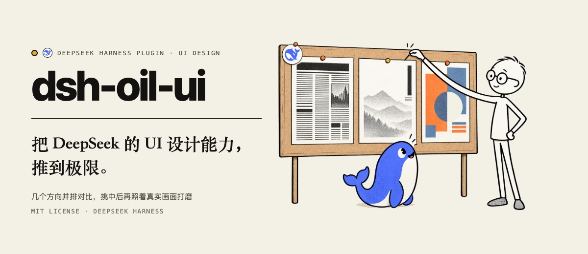
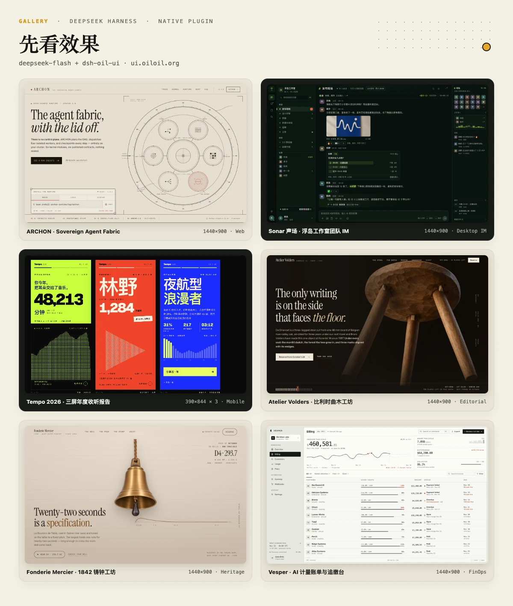
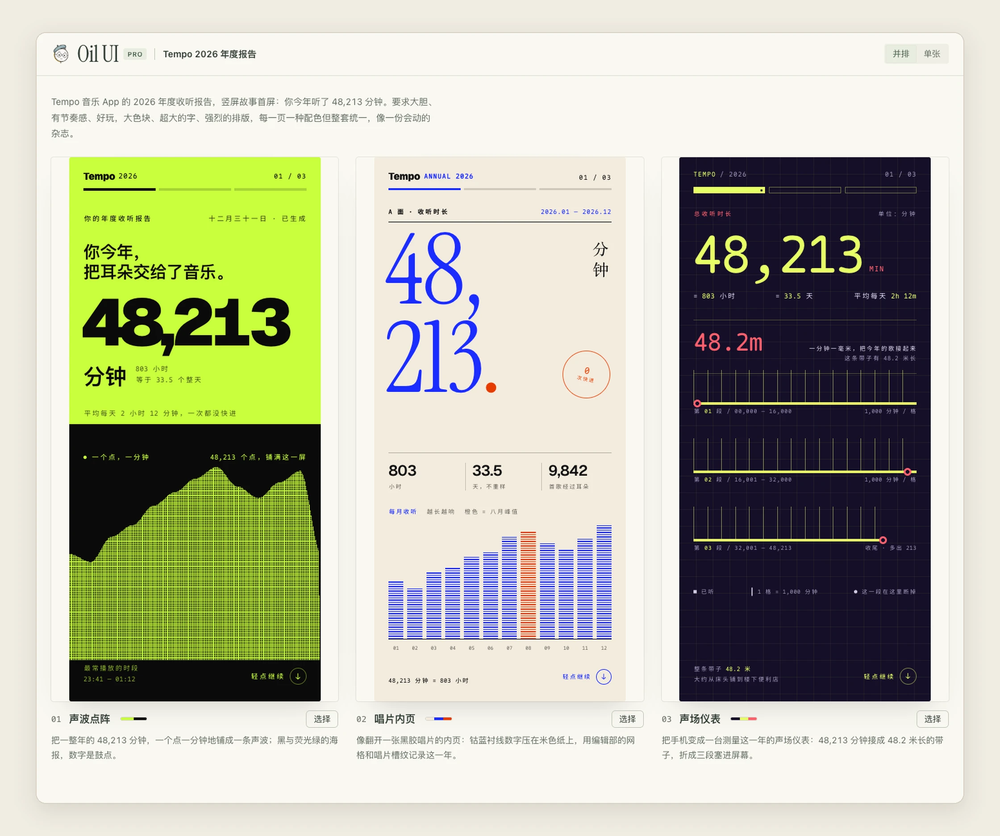
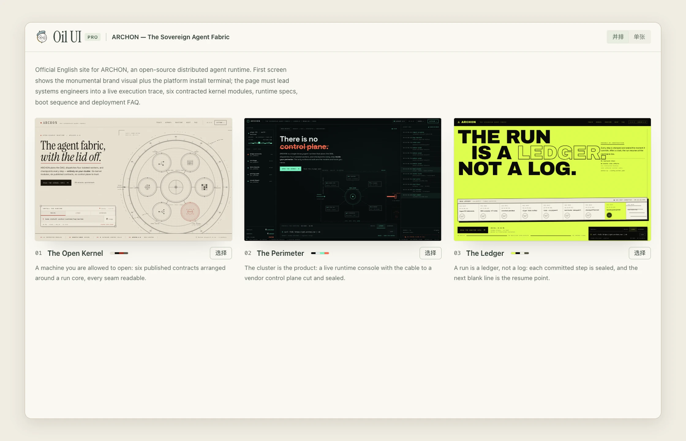

<p align="center">
  
</p>

<p align="center">
  <a href="https://ui.oiloil.org">作品画廊</a> ·
  <a href="https://ui.oiloil.org/pro/">Oil UI Pro</a> ·
  <a href="https://github.com/oil-oil/oil-ui">上游 oil-ui</a> ·
  <a href="#安装">安装</a> ·
  <a href="#原生工具与快捷命令">原生工具</a> ·
  <a href="README.en.md">English</a>
</p>

---

**`dsh-oil-ui` 是 [oil-ui](https://github.com/oil-oil/oil-ui) 的 DeepSeek Harness 原生插件。**

它把 `oil-ui` 的界面设计流程直接接进 `@deepseek-ai/dsh`：先在同屏对比页里摆开 3 个真正拉开差距的方向，挑定后再在当前目录里写代码、截真图、点交互、查多端，照着真实画面一轮轮把界面改到位。

关于设计方法与作品画廊，可直接看 **[oil-ui 仓库](https://github.com/oil-oil/oil-ui)** 和 **[ui.oiloil.org](https://ui.oiloil.org)**。这里重点说明 `dsh-oil-ui` 在 DeepSeek Harness 里做了什么，以及怎样配合 **Oil UI Pro** 使用。

<p align="center">
  
</p>

上图 6 件作品（`ARCHON`、`Sonar 声场`、`Tempo 2026`、`Atelier Volders`、`Fonderie Mercier`、`Vesper`）均由 `DeepSeek 4.1 Flash` 搭配 `dsh-oil-ui`，仅凭一段简短任务描述在隔离目录里自主探索、生成对比页并完成全部交互与多端校验。

---

## 为什么做原生插件

DeepSeek Harness 本身已经有文件读写（`read` / `write` / `edit`）、终端（`bash`）、看图（`read_image`）和子代理（`subagent`）。如果再包一层项目沙箱或过渡 `ADAPTER`，模型反而要在两套读写工具和两套目录规则之间来回猜。

`dsh-oil-ui` 直接按 DeepSeek Harness 的原生插件机制设计：

- **直接在当前工作目录读写**：不创建额外的 `projects/<uuid>` 嵌套目录，页面、样式、脚本和截图都落在当前目录，和原生 `read` / `write` / `read_image` 完全一致。
- **只注册 `oil-ui` 独有的 5 个工具**：对比页打包、浏览器截图与交互巡检、公有领域素材检索、AI 生图修图，以及 Skill 状态检查。
- **从上游 `oil-ui` 自动编译派生**：插件把上游 `SKILL.md` 和 `references/*.md` 里的命令行示例自动改写为原生工具调用。上游更新后，跑一条 `pnpm vendor:skill` 就能同步派生，不用手工维护两套文档。

---

## 在 DeepSeek Harness 里怎么跑

给一句简单的需求，Agent 会自己走完 **探索方向 → 生成同屏对比页 → 实现完整页面 → 截图与子代理走查**：

<p align="center">
  
</p>

<p align="center">
  
</p>

1. 先调 `oil_ui_skill_status` 检查当前可用的 Skill（已装 `oil-ui-pro` 会优先使用 Pro），再用原生 `skill` 工具加载指南和对应分册。
2. 在 `explore/` 下写出 3 个构图、色调和视觉引擎完全不同的首屏候选，调 `oil_ui_explorer` 打包出单文件 `style-explorer.html`。
3. 选定方向后写出完整的 `index.html`（或多屏 `screens.html`），调 `oil_ui_shoot` 在真实无头浏览器里截图、模拟点击与输入、检查多端断点，并用原生 `read_image` 看图改到干净为止。

---

## 原生工具与快捷命令

插件向模型暴露 5 个专用工具，参数全部以当前工作目录（`cwd`）为基准：

| 工具 | 作用 |
| --- | --- |
| `oil_ui_skill_status` | 刷新本地 Skill 状态，返回当前生效的 `activeSkillName`（`oil-ui` 或 `oil-ui-pro`），同时处理版本更新检查和一次性 Pro 提示 |
| `oil_ui_explorer` | 读取 `explore/manifest.json`（兼容常见简写字段），把多个首屏候选内联打包成可交互的 `style-explorer.html` 对比页 |
| `oil_ui_shoot` | 在真实浏览器里打开本地页面或 URL：支持指定视口尺寸、2x 特写、多状态连拍（`states`）、交互步骤脚本（`steps`）、录屏抽帧（`record` / `motion`）以及证据拼图（`evidence`），并自动检查控制台报错、横向溢出、断图与文字对比度 |
| `oil_ui_media` | 搜索、预览和下载免版权/公有领域图片、博物馆馆藏（Met、AIC、Cleveland、Wikimedia、Openverse 等）、视频与地图素材 |
| `oil_ui_image` | 调用本地 `image-gen` Skill 生成或编辑网页主视觉、插画、纹理和透明底抠图素材 |

同时向聊天输入框注册 3 个以 `oil-ui-` 为前缀的 Slash 快捷命令（与其他 `oil-*` 系列 Skill 区分）：

| 命令 | 作用 |
| --- | --- |
| `/oil-ui-status [update]` | 直接查看当前生效版本（`oil-ui` / `oil-ui-pro`）、更新状态与 `image-gen` 状态；带 `update` 参数时直接原地更新 |
| `/oil-ui-explore <需求描述>` | 支持附带参考图/文件，直接发起三方向探索并生成 `style-explorer.html` 对比页 |
| `/oil-ui-review [目标页面或文件]` | 支持附带截图/文件，对目标页面抓真图并执行视觉层级 + 可用性双轨走查 |

---

## Oil UI Pro 与更新检查

`dsh-oil-ui` 内置免费版 `oil-ui`，开箱就能跑通方向探索与同屏对比页。如果你经常做正式上线页、复杂工作台或需要多轮视觉精修，可以搭配 **[Oil UI Pro](https://ui.oiloil.org/pro/)** 使用。

### Oil UI Pro 多了什么

| 能力 | `oil-ui`（内置免费版） | `Oil UI Pro` |
| --- | :---: | :---: |
| 设计方向探索 + `style-explorer.html` 同屏对比 | ✓ | ✓ |
| 真实截图驱动的多轮视觉精修与对比度/排版巡检 | — | ✓ |
| 多状态连拍（`states`）、交互步骤（`steps`）与录屏抽帧 | — | ✓ |
| 博物馆/公有领域素材检索（`oil_ui_media`）与 AI 生图修图（`oil_ui_image`）完整分册 | — | ✓ |
| 独立视觉评审子代理（`oil-ui-reviewer`）逐轮打分与走查 | — | ✓ |
| 完整场景分册（营销落地页、数据后台、移动多屏、重绘改版、字体子集化） | — | ✓ |

### 自动识别本地 Pro

在本机安装好 `oil-ui-pro`（默认位于 `~/.agents/skills/oil-ui-pro` 或 `~/.dsh/skills/oil-ui-pro`）后，不需要重启 DeepSeek Harness。Agent 在任务开始调用 `oil_ui_skill_status` 时，插件会重新扫描本机目录，把 `oil-ui-pro` 的 `SKILL.md` 和分册编译为原生工具说明，并返回 `activeSkillName: "oil-ui-pro"`。

### 版本检查与一次性 Pro 提醒

原来在 `oil-ui` 脚本里的版本更新检查和一次性 Pro 推荐，在 `dsh-oil-ui` 里直接合进了 `oil_ui_skill_status`：

- **版本检查与一键更新**：调用 `oil_ui_skill_status` 时，插件每 10 分钟向 `https://ui.oiloil.org/api/store/versions` 静默核对一次版本号（结果缓存在 `~/.local/state/oil/<name>-update.json`，网络超时自动跳过，绝不阻塞任务）。发现新版本时会在返回结果里附上 `updateNotice`；传入 `{"update": true}`（或执行 `/oil-ui-status update`）可直接把当前生效的 Skill 更新到最新。
- **一次性 Pro 提醒**：当本机只装了免费版 `oil-ui` 时，首次调用 `oil_ui_skill_status` 会在 `~/.local/state/oil-ui/recommended-oil-ui-pro` 写下标记，并返回一次 `recommendOnceNotice`，让 Agent 在任务收尾时顺带提一句 [ui.oiloil.org/pro](https://ui.oiloil.org/pro/)，之后不再重复打扰。

---

## 安装

### 1. 构建并打包插件

```bash
git clone https://github.com/oil-oil/dsh-oil-ui.git
cd dsh-oil-ui
pnpm install
pnpm pack:plugin
```

打包完成后会在 `.work/` 下生成 `dsh-oil-ui-<version>.tgz`。

### 2. 安装到 DeepSeek Harness

```bash
dsh plugin install ./.work/dsh-oil-ui-0.3.1.tgz
```

### 3. 可选配置（`~/.dsh/config.yaml`）

如果需要使用 `oil_ui_image` 生图，或者想指定自定义的本地 Skill 路径，可以在配置里传入：

```yaml
plugins:
  entries:
    dsh-oil-ui:
      enabled: true
      config:
        # 可选：优先加载指定目录下的 oil-ui 或 oil-ui-pro
        # skillDir: /Users/you/.agents/skills/oil-ui-pro
        openrouterApiKey: ${OPENROUTER_API_KEY}
        imageModel: google/gemini-3.1-flash-image-preview
```

---

## 从上游 `oil-ui` 同步更新

当上游 `oil-ui` 更新了 `SKILL.md`、分册或脚本时，在仓库根目录运行：

```bash
pnpm vendor:skill   # 同步 ../oil-ui（或设置 OIL_UI_SOURCE_DIR）
pnpm test           # 运行插件与编译转换测试
pnpm pack:plugin    # 重新构建并打出 .tgz 插件包
```

---

## 许可

基于 [MIT License](LICENSE) 开源。
